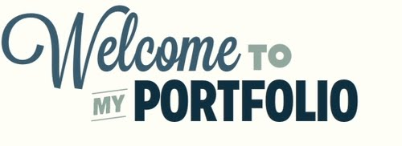

### Hi, I'm Andre Kim 👋

  

---

## 🚀 About me

Data scientist based in Dublin. I spent five years at **Bradesco**, one of Brazil's biggest banks, working as an internal data science consultant for the CRM, Marketing, Investments and Retail teams. That meant credit scoring models, customer segmentation, ETL pipelines and the dashboards that sat on top of them.

These days I'm mostly working with **LLMs, NLP and RAG**, and I learn best by building things, so that's what this page is for.

---

## 🤖 Projects

| Project | What it does | Stack |
|---|---|---|
| [**Cancer Mutation Classifier**](https://github.com/andrescarton/Personalized_Medicine_Redefining_Cancer_Treatment) | Predicts the clinical class of a genetic mutation from the gene, the variation and medical text. I rebuilt an old notebook after finding leakage bugs in it, and a calibrated linear SVM ended up beating fine-tuned PubMedBERT | Python · scikit-learn · TF-IDF · PubMedBERT · Streamlit |
| [**Santander Customer Satisfaction**](https://github.com/andrescarton/santander-customer-satisfaction) | Flags unhappy bank customers before they leave. 6 models compared, final one cut from 30 features to 10 with no real loss (ROC-AUC 0.836) | Python · scikit-learn · Streamlit |
| [**AI Investment Robot**](https://github.com/andrescarton/Ai-Investment) | A local LLM reads the news about a stock, combines it with price trend and performance vs. the S&P 500, and gives a buy / hold / sell call | Python · Llama 3.2 · Ollama · NewsAPI · yfinance |

🧬 Cancer Mutation Classifier live app → **[open the app](https://personalizedmedicineredefiningcancertreatment-mrxi9mpbul7oakwi.streamlit.app/)**
📊 AI Investment Robot sample report → **[andrescarton.github.io/Ai-Investment](https://andrescarton.github.io/Ai-Investment/)**

---

## 🧠 What I work with

#### 💻 Core

#### 🤖 AI & Machine Learning

#### 🧬 Generative AI & LLMs

#### ⚙️ Data Engineering

#### 📊 Analytics & BI

#### ☁️ Cloud & Infrastructure

#### 🌱 Currently learning

---

## 🏦 Where I've been

**Data Analyst | Data Scientist @ Bradesco Bank** *(2017 – 2022)*
One of Brazil's top 5 banks · 70M+ customers · Data Management Department

- Built and deployed **credit scoring models** with XGBoost
- Built **ETL pipelines** in Python and PySpark, which cut manual reporting work by about **40%**
- Created a **customer segmentation** (K-Means) that the marketing team used to plan campaigns
- Made **executive dashboards** in Tableau, Power BI and MicroStrategy
- Worked with CRM, Marketing, Investments, HR and Retail, explaining model results to people who didn't need the maths

---

## 🎓 Education

🎓 **Higher Diploma in Science in Computing** · Griffith College, Dublin · 2024–2025
⚡ **Bachelor's in Electrical Engineering** · Instituto Mauá de Tecnologia, Brazil · 2016–2021

---

## 💬 Find me

⚽ Playing football · ☕ Studying in a coffee shop · ✈️ Travelling
📫 andre.kim1@hotmail.com
